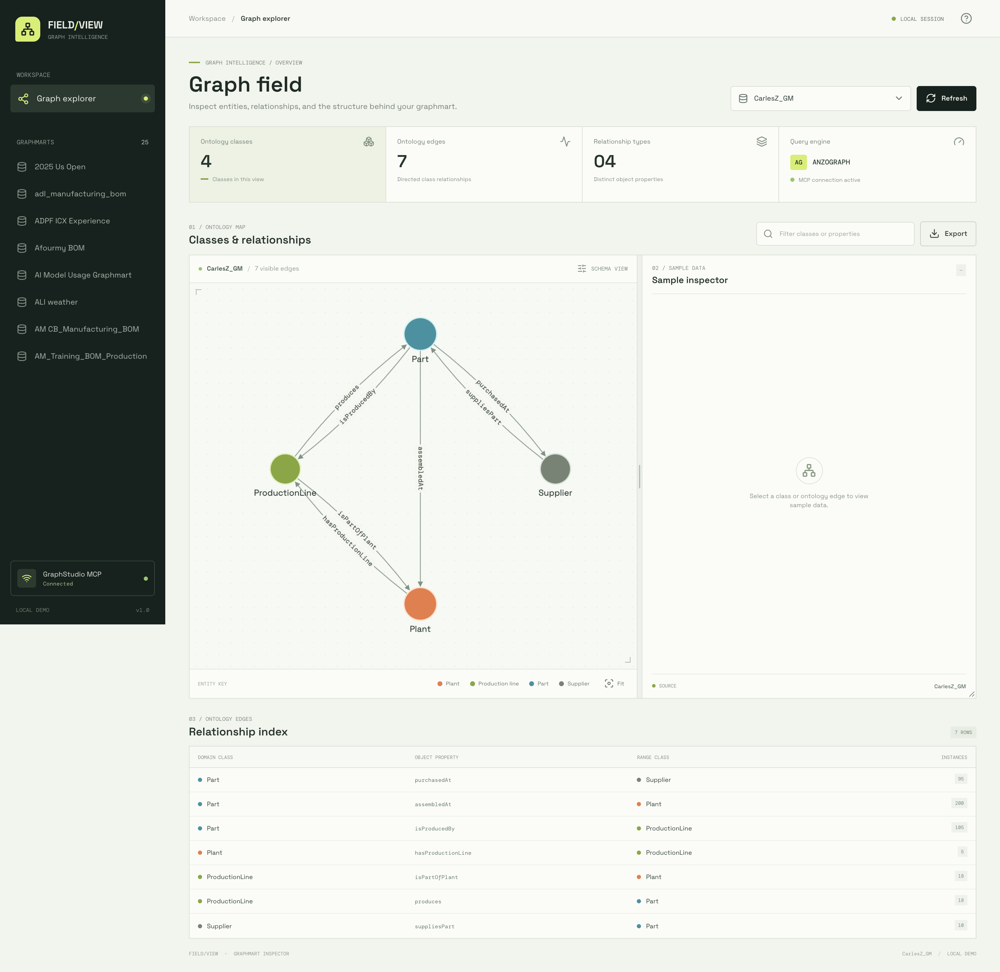
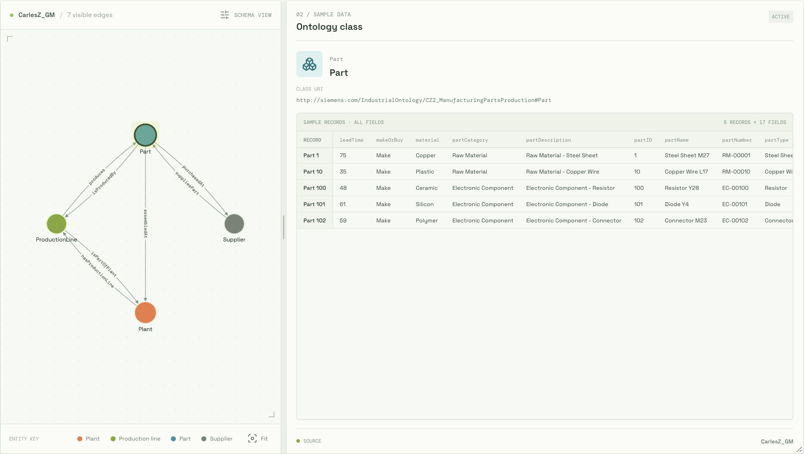
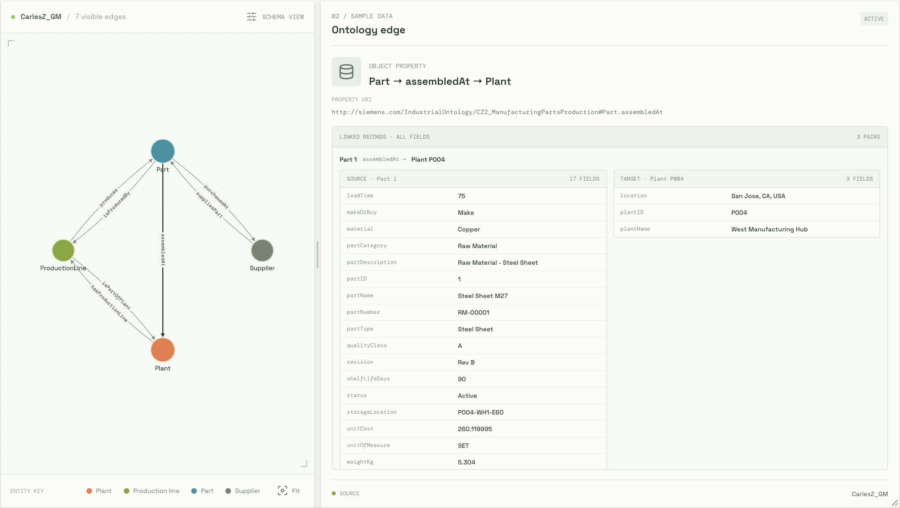
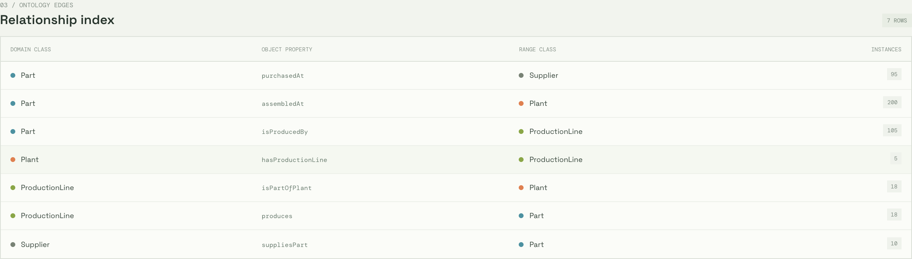
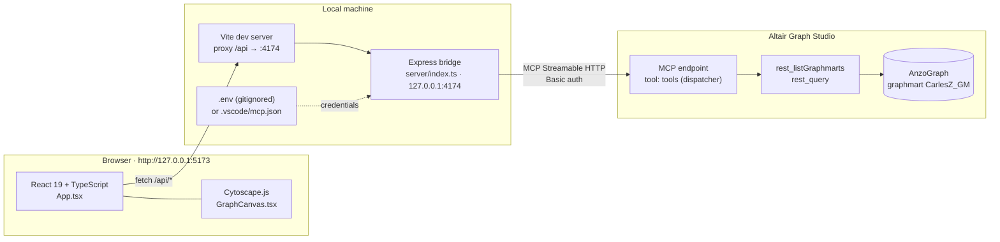
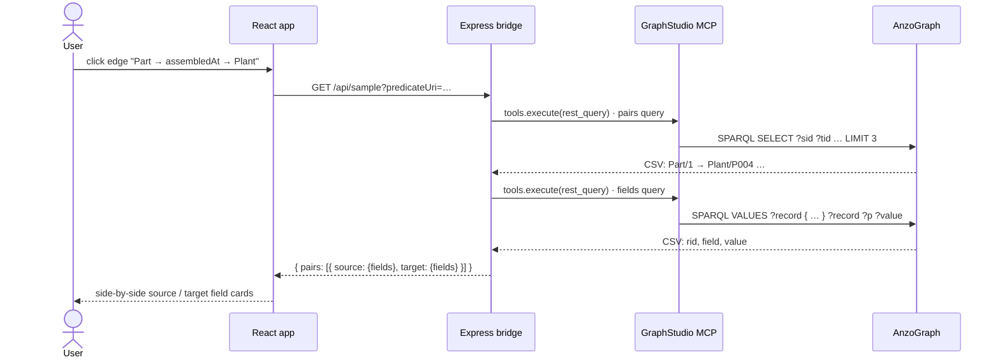

# Graphmart Field View

A local, desktop-first demo app that visualizes an **Altair Graph Studio graphmart** as an interactive ontology map, powered by the **GraphStudio MCP server**.

Pick a graphmart, explore its classes and object properties as a graph, and click any class or relationship to see real sample data — every field, straight from the graph.

> **Version 1.0.0** · Local demo only — no authentication on the app itself.



---

## Features

- **Ontology map** — classes as nodes, object properties as directed edges (Cytoscape.js), derived live from the graphmart data.
- **Class sample** — click a class (e.g. `Part`) to see sample records as a table with **all literal fields** as columns.
- **Edge sample** — click a relationship (e.g. `Part → assembledAt → Plant`) to see linked record pairs with **all fields of both the source and the target**.
- **Resizable workspace** — drag the divider between graph and data panel, and drag the bottom-right corner to make the area taller. The graph refits automatically.
- **Relationship index** — table of domain class → property → range class with instance counts; every cell is clickable.
- **Graphmart picker**, filter box, and CSV export of the ontology edges.

| Class selected | Edge selected |
| --- | --- |
|  |  |



---

## Architecture

The browser never talks to GraphStudio directly. A small local Express bridge holds the credentials, speaks MCP to GraphStudio, and exposes three narrow JSON endpoints to the React app.



### API endpoints (local bridge)

| Endpoint | Purpose | GraphStudio call |
| --- | --- | --- |
| `GET /api/health` | MCP connectivity check | `listTools` |
| `GET /api/graphmarts` | Graphmarts for the picker | `rest_listGraphmarts` |
| `GET /api/graph?graphmart=` | Ontology classes and object-property edges | `rest_query` (SPARQL, CSV) |
| `GET /api/sample?graphmart=&classUris=` | Sample records of a class, all fields | `rest_query` |
| `GET /api/sample?graphmart=&predicateUri=&sourceClassUris=&targetClassUris=` | Linked record pairs of an edge, all fields of both ends | `rest_query` ×2 |

### Click-to-sample flow



### How the ontology map is derived

The schema graph is built from the data itself, so it only shows relationships that actually have instances:

```sparql
SELECT ?sourceClass ?predicate ?targetClass (COUNT(DISTINCT ?subject) AS ?instances)
WHERE {
  ?subject rdf:type ?sourceClass ; ?predicate ?object .
  ?object  rdf:type ?targetClass .
  FILTER(STRSTARTS(STR(?sourceClass), "<ontology namespace>"))
  FILTER(STRSTARTS(STR(?targetClass), "<ontology namespace>"))
  FILTER(STRSTARTS(STR(?predicate),   "<ontology namespace>"))
}
GROUP BY ?sourceClass ?predicate ?targetClass
```

Subclasses `MakePart` and `BuyPart` are merged into a single `Part` node.

---

## Getting started

### Prerequisites

- Node.js **20.12+** (developed on Node 25)
- Access to a GraphStudio instance with the MCP endpoint enabled

### 1 · Install

```bash
git clone https://github.com/carlesz/graphmart-field-view.git
cd graphmart-field-view
npm install
```

### 2 · Configure credentials

```bash
cp .env.example .env
```

Edit `.env`:

```dotenv
GRAPHSTUDIO_MCP_URL=https://your-graphstudio-host/mcp
GRAPHSTUDIO_USER=your-username
GRAPHSTUDIO_PASSWORD=your-password
```

If `GRAPHSTUDIO_MCP_URL` is not set, the bridge falls back to the VS Code MCP config at `.vscode/mcp.json` (see `.vscode/mcp.example.json`). Both `.env` and `.vscode/mcp.json` are gitignored.

### 3 · Run

```bash
npm run dev
```

This starts both processes:

| Process | URL |
| --- | --- |
| Web (Vite) | http://127.0.0.1:5173 |
| API bridge (Express) | http://127.0.0.1:4174 |

Open http://127.0.0.1:5173 — `CarlesZ_GM` is selected by default when present.

### Scripts

| Script | Description |
| --- | --- |
| `npm run dev` | Web + API with hot reload |
| `npm run build` | Type-check and build the web app to `dist/` |
| `npm run start` | Run the API bridge only |
| `npm run lint` | Oxlint |

---

## Project structure

```
├── server/
│   └── index.ts          # Express bridge: MCP client, SPARQL queries, CSV parsing
├── src/
│   ├── App.tsx           # Layout, state, data loading, sample inspector
│   ├── GraphCanvas.tsx   # Cytoscape.js ontology graph
│   ├── types.ts          # Shared types
│   ├── dashboard.css     # Styles
│   └── main.tsx
├── docs/screenshots/     # README images
├── .env.example          # Credential template (copy to .env)
└── .vscode/mcp.example.json
```

---

## Security notes

- Intended for **local demos only**. Both servers bind to `127.0.0.1`; the app has no login.
- GraphStudio credentials stay in the Node bridge and are never sent to the browser.
- Credentials live only in `.env` or `.vscode/mcp.json`, both gitignored. Never commit them.
- Query inputs from the browser are validated (ontology-namespace URIs only) before being placed in SPARQL.

## Known limitations

- GraphStudio's MCP layer truncates large tool results (~8 KB), so samples are intentionally small: **5 records** per class and **3 linked pairs** per edge. Ids and field names are shortened in SPARQL to fit.
- The ontology namespace (`CZ2_ManufacturingPartsProduction`) and instance namespace are configured in `server/index.ts` for the `CarlesZ_GM` demo graphmart.
- The graphmart list shows the first 25 graphmarts.
- Desktop layout only (minimum width 1024 px).

## Tech stack

React 19 · TypeScript · Vite · Cytoscape.js · lucide-react · Express 5 · MCP TypeScript SDK (`@modelcontextprotocol/client`) · csv-parse
